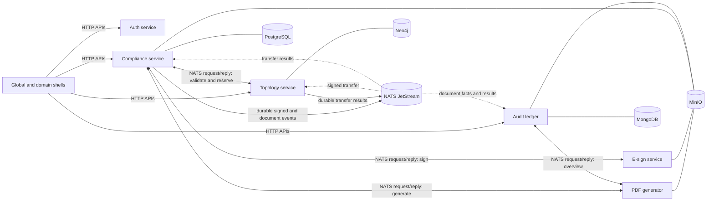

<!-- File: README.md -->
# Distributed Systems Architecture Portfolio

An aerospace-themed portfolio demonstrating custody transfers across a
microservice system. Organizations use federated UI workflows to prepare and
sign transfer authorizations and receipts; services validate custody, reconcile
events, and preserve an audit record. This is a local demonstration, not a
production flight-readiness or telemetry system.

## 1. System and architecture



The arrows between services labeled request/reply are blocking NATS requests,
not direct HTTP links. Event delivery is asynchronous and retried using durable
outboxes. The [generated service composition and interaction view](./docs/generated/architecture/architecture.md)
shows the federated widgets and communication types.

### Services and workflow

- **Global and domain shells** compose the auth, topology, compliance, and audit
  micro-frontends. Users select a demo profile and work with the scoped data.
- **Auth** issues identities and roles. The profile picker is impersonable and
  intended for fictional local data, not production authentication.
- **Topology** owns the Neo4j custody graph. It validates draft facts and
  reserves assets synchronously over NATS. It consumes signed events, applies
  physical or C2 transitions, and publishes committed results.
- **Compliance** coordinates draft generation and signing, records documents
  and participant access in PostgreSQL, and durably publishes signed events.
  Signing returns without waiting for topology's eventual application; the UI
  shows pending, applied, or attention-required synchronization.
  While the signing workflow remains open, it checks for application and
  refreshes receipt-page options when the update is applied. The signed receipt
  remains visible until another selection is made. Graph caches in the current
  browser session are invalidated on save and application; this is not a
  cross-tab or cross-user live update.
- **Audit ledger** consumes document facts and topology snapshots, seals
  completed transfer records only when required receipts are present, and
  requests PDF overviews. Its MongoDB-backed records are participant-scoped.
- **PDF generator and e-sign** render and cryptographically sign documents;
  MinIO stores artifacts and serves time-limited signed downloads. Multi-page
  transfer forms place their signing block on a final page, where e-sign applies
  the visual signature and date.

Current custodians and intended receivers of in-transit assets may view the
asset's full visual transfer history. Transfer participants can access their
own documents, while platform auditors have global read-only access.
The selected page is reflected in the URL, so reloading or sharing a page link
returns to the same page. Switching domains opens that domain's default page.
On the network canvas, drag individual nodes or Shift-drag a node to move it
and its directly connected neighbors. Arrangements last only while that canvas is open.
Reservations cover authorizations and receipts to prevent overlapping
signatures. See the [ADRs](./docs/adr/) for design decisions.

### Generated Architecture and Software Inventory

CI builds every application image declared in `skaffold.yaml`, then generates a CycloneDX JSON SBOM and a visual HTML report for each image. The [generated SBOM index](./docs/generated/sbom/index.md) links to each report. The structured [architecture model](./docs/architecture/model.json) separately records page/widget composition, storage, and communication patterns; it is rendered as both Markdown (Mermaid) and HTML.

On pull requests and pushes, the reports are attached to the GitHub Actions run as the `sbom-and-architecture-reports` artifact. On pushes to `master`, after the verification and report-generation jobs pass, CI opens or updates a pull request with changed outputs under `docs/generated/`, then explicitly runs verification against that report branch. It avoids replacing a committed image report when the image digest and report-tool versions are unchanged. This requires GitHub Actions to have Actions, repository contents, and pull-request write permissions; the report updates still go through the normal `master` review and branch-protection process.

Trivy runs with its license scanner for inventory metadata, not its vulnerability scanner. Sunshine displays a vulnerability summary, but a zero count here means vulnerability data was not included; it does not mean a vulnerability scan passed.

Adding a deployable image to `skaffold.yaml` is enough for it to be included in SBOM generation. Update `docs/architecture/model.json` when UI composition, storage nodes, or interactions should change in the architecture view. For local generation, prepare the pinned [CycloneDX Sunshine revision](https://github.com/CycloneDX/Sunshine/tree/beaab3faf2bab234069a8677fc627de2f0f01a3d):

```bash
mkdir -p .tools
git clone https://github.com/CycloneDX/Sunshine.git .tools/cyclonedx-sunshine
git -C .tools/cyclonedx-sunshine checkout beaab3faf2bab234069a8677fc627de2f0f01a3d
python3 -m pip install requests==2.32.5
pnpm docs:generate
```

The command also requires Docker with Buildx, Skaffold, Trivy, and Python 3; `SUNSHINE_CLI` can point to a different `sunshine.py` path.

---

## 2. Local Development

The integrated development workflow uses Docker, k3d, Kubernetes, Helm (Traefik, `traefik-shared`, and every service/shell chart under `charts/`), and Skaffold. Traefik is exposed through the k3d load balancer at `http://localhost:8081`; no manual `kubectl port-forward` is required.

Shared visual patterns such as surfaces, navigation tabs, and text are defined
in [global.css](./packages/styles/src/global.css). They use Tailwind's component
layer so individual components can still add utility classes for layout and
local adjustments. Component-specific styling stays with the component.

### Fresh Environment

Install Git and Docker Desktop or Docker Engine first. On Linux or WSL, the current user must be able to run Docker commands. Docker must be running before `setup.sh` starts.

Clone the repository and enter the workspace:

```bash
git clone git@github.com:Brickwall72/distributed-systems-architecture-portfolio.git
cd distributed-systems-architecture-portfolio
```

Run the bootstrap with Bash. Do not use pnpm before this step; the script installs pnpm when it is missing:

```bash
BUILD_DOCKER_BASE=true bash setup.sh
```

`setup.sh` installs or verifies Python 3.9 or newer, Node.js, pnpm, kubectl, Helm, k3d, and Skaffold; installs workspace dependencies; builds the workspace; and prepares local environment files and credentials. If Python is missing or too old, it installs Python 3.12 through Homebrew and adds it to your shell profile. With `BUILD_DOCKER_BASE=true`, it also builds `base-image:local`. Cluster creation and Traefik installation are separate commands below. The k3d cluster maps host ports `8081` and `8443` to the Traefik load balancer.

If the script updates your shell profile, reload it before using pnpm in a new shell:

```bash
source ~/.bashrc  # Linux/WSL
# or: source ~/.zshrc  # macOS
```

The setup script already prepares local environment files after installing
Python and pnpm. To repeat only the non-destructive template merge later, run:

```bash
pnpm env:copy
```

The environment and secret bootstrap scripts require Python 3.9 or newer.
The command creates missing `.env` files and adds variables missing from existing
files. It preserves existing values and local-only variables, and reports
differences from the template by variable name. In particular, changed template
defaults are not automatically applied to existing values; review those
differences after pulling changes. To deliberately replace all local files with
their templates, run `pnpm env:reset` and confirm the warning. Replacing
credentials in `.env` does not update passwords already stored in persistent
databases and can prevent the platform from starting.
The credential helpers accept simple `KEY=value` or fully quoted values; they
reject interpolation and unsupported escaping rather than interpreting a
credential differently from Compose.

If setup reports conflicting MinIO identities after a pull, `env:copy` has
preserved older shared `S3_ACCESS_KEY` or `S3_SECRET_KEY` values. The error
identifies the affected file and variable names without printing their values.
Compare those entries with the adjacent `.env.example` files; the root MinIO
credentials and each service's access key and secret must be distinct.
Back up current credentials and data before changing them. If all existing
local data is disposable, use the explicitly confirmed reset procedures below,
then update the conflicting entries from their templates and rerun
`pnpm dev:prepare` or `bash setup.sh`. If data must be retained, follow the
manual credential recovery/rotation guidance below instead: changing `.env`
alone does not provision accounts or rotate passwords in persistent stores.

### Start the Local Platform

Run these steps in order from a freshly bootstrapped workspace.

Select or create the k3d cluster:

```bash
pnpm k3d:up
```

Ensure Traefik and the shared Traefik middlewares are installed:

```bash
pnpm helm
```

Vendor `platform-lib` into every service/shell chart's `charts/` directory. Run this once after clone and again whenever `charts/platform-lib` or any chart's `Chart.yaml` dependencies change:

```bash
pnpm charts:deps
```

Create the Kubernetes database credentials while the cluster API is available:

```bash
pnpm k8s:secrets
```

The helper operates only on context `k3d-platform-cluster` and the
`platform-local` namespace. It prepares credentials from the service `.env`
files and requires all relevant values to be present. If a database Secret does
not exist and its storage is new, it uses those credentials. On subsequent runs it
checks the existing Secrets rather than overwriting them. It refuses conflicting
local values or missing credentials alongside existing storage or workloads;
recover the original credentials before retrying instead of deleting data.
NATS and auth key files must match any existing Kubernetes Secrets.

Start the integrated development deployment and leave it running:

```bash
pnpm skaffold
```

### Integrated Kubernetes Development

After the ordered startup steps above, open the application at
[http://localhost:8081](http://localhost:8081). Useful checks are:

For a complete rebuild without cached artifacts, stop the current Skaffold
process first, then run:

```bash
pnpm skaffold:reset
```

```bash
kubectl config current-context
kubectl get pods,svc,ingress -A
curl -i http://localhost:8081/
curl -i http://localhost:8081/topology/client/remoteEntry.js
curl -i http://localhost:8081/compliance/client/remoteEntry.js
curl -i http://localhost:8081/topology/api/v1/health
curl -i http://localhost:8081/pdf/api/v1/health
```

The expected Kubernetes context is `k3d-platform-cluster`. The browser reaches
the application and APIs through Traefik on `localhost:8081`. The charts use
port `3000` for client/shell containers and `8080` for server containers;
these are internal ports, not separately published host ports.

PDF presigned URLs use `http://minio.localhost:8081`, routed to the MinIO S3 API Service on port `9000` (not the web console on port `9001`). The MinIO API allows browser CORS for this local workflow; a successful presigned download should return `Content-Type: application/pdf`.

The compliance document viewer also signs download URLs. The compliance server uses
`S3_PUBLIC_ENDPOINT`, `S3_REGION`, `S3_ACCESS_KEY`, and `S3_SECRET_KEY`: Compose
reads them from the compliance service environment, while the Helm chart reads
credentials from `minio-credentials`. Set the public endpoint to the exact
browser-reachable S3 origin before deployment; `minio.localhost` works only on
the local machine. Remote deployments need an HTTPS endpoint, compatible S3
ingress and CORS permitting the frontend origin; rewriting a URL after signing
invalidates its signature. Configure the same browser-reachable
`S3_PUBLIC_ENDPOINT` for the PDF and e-sign services, which also issue URLs.

Compliance drafts use topology-owned organization and asset facts, and signing
uses topology-owned reservations and atomic custody transitions. Draft
validation and authorization/receipt reservations use synchronous NATS
request/reply. After e-signing, compliance saves the document and durable event
intents before returning the PDF; topology applies the reserved transition
asynchronously. The workflow and document table show pending, applied, or
attention-required synchronization. A pending update needs attention after five
minutes or when publication fails; the status clears when recovery completes.
Signing is durable and may continue after a timeout; retry the identical request
rather than creating a replacement signature. An unresolved signing operation retains
its signature image in the compliance database until completion or a pre-signing
conflict. Restrict database access, encrypt backups, and monitor retry failures;
never discard an uncertain operation or release its signing claim without first
reconciling the signed artifact and topology state. Fresh topology graphs start
with fictional organizations and at least twelve available assets, but no
transfer history. The seed runs only when no topology entities exist, so it
does not replace existing graphs or recreate custody relationships on restart.
New transfers must be created through the normal workflow.

The topology Kubernetes chart now uses a PVC for Neo4j data. An upgrade from a
running non-persistent topology deployment is blocked by default because
switching volumes would replace its currently visible graph with a different
one. Back up or deliberately discard that graph before enabling the explicit
Helm override `database.persistence.allowStorageTransition=true`. The override
does not migrate data. The Neo4j deployment uses the Recreate strategy to avoid
concurrent writers to the PVC, so upgrades and restarts cause brief downtime.
Compose already uses a named volume.
The Helm charts retain database, MinIO, NATS and DBGate PVCs when a release is
uninstalled, including Skaffold cleanup. Their contents and credentials remain
the operator's responsibility; deleting a namespace, PVC, backing volume, or
cluster is a separate destructive operation and is not prevented by Helm's
retention annotation. Reinstall the same releases against the retained claims
and original Secrets, or deliberately remove the claims only after a backup and
an explicit decision to discard their contents.
Neo4j Community Edition does not provide the fine-grained role commands needed
to enforce graph permissions per demo profile. The topology service connects
using its database credentials and enforces profile and organization access at
the application boundary; signing into the UI does not create a database user.
Topology validates `PORT` (default `8080`), `NATS_URL` (default
`nats://localhost:4222`), and `NODE_ENV` (default `development`) through its
[server configuration](services/core/topology-service/server/src/config.ts).
If changing `PORT`, also align the container port mappings and health probes.
The e-sign service requires a readable P12 certificate and a matching
`SIGNING_CERT_PASSWORD`; signing fails rather than returning an unsealed PDF
when the certificate or cryptographic seal cannot be applied. The legacy
`CERT_PASSPHRASE` variable is accepted if `SIGNING_CERT_PASSWORD` is unset.
Demo login also allows callers to select any seeded identity. Compose and Helm
configure the `dsap` bucket without anonymous access, but a presigned URL can
be used by anyone holding it until it expires. Use fictional data only; this
development configuration does not protect sensitive documents. NATS uses
per-service identities, subject permissions, and private reply inboxes.
Topology and compliance create or verify their own event streams; subscribers
create or verify their own durable consumers. Permissions authorize those
specific JetStream operations rather than granting unrestricted administration.
PDF generation uses separate NATS subjects for compliance drafts and audit
overviews; each caller is permitted only its own subject, and the PDF service
rejects keys outside the subject's domain prefix. Deploy the broker policy,
PDF worker, and both callers together: older audit clients still using the
compliance subject will be denied. E-sign currently accepts only compliance draft
keys and matching compliance transfer destinations; future domains require
their own authorized request boundary before being enabled.
The local broker connections are plaintext and the local credentials are not a
production secret-management solution. Use TLS, network isolation and managed
secret rotation for a real deployment.

### Service-Level Compose Development

Use Compose when working on individual containers without the Kubernetes stack. The root Compose file includes the service-owned definitions and does not bind port `8081`:

```bash
pnpm docker:base
docker compose up --build -d
```

`pnpm docker:base` runs `pnpm dev:prepare` before building. To prepare credentials
without rebuilding the image, run `pnpm dev:prepare`; afterward plain
`docker compose up` is supported. Service `.env` files are the editable
credential source for both Compose and `pnpm k8s:secrets`. Re-run preparation
after editing them. Per-workload generated files in the ignored
`.auth-keys/local/` directory feed Compose and local Kubernetes; exported shell
DB, S3 and signing-password variables do not override those credentials.
Non-secret Compose settings can still be overridden as usual. MinIO root and
each service have distinct credentials, as do the PostgreSQL and MongoDB
administrator and application users. The signing password must match the local
P12 certificate. Reconcile errors before starting.

The local directory is a symlink to a protected, atomically published generation
in `.auth-keys/local-generations/`. Old generations remain for readers that may
already be using them and contain old credentials: protect them and remove
unneeded generations only after stopping concurrent preparation and deployments.
If preparation reports a stale `.local-credentials.lock`, verify no preparation
is running before removing that lock directory. NATS passwords live separately
in `.auth-keys/nats/`; JWT keys and the P12 certificate retain their existing
locations. Preserve and back up matching key and password files; partial NATS
or JWT material is rejected rather than silently replaced. The `.auth-keys`
directory is private to the host user. Compose starts an authenticated broker, then services initialize their own
streams and consumers. Existing JetStream data and consumer acknowledgements are
preserved; incompatible subject or consumer configuration fails rather than being
silently replaced. Do not commit these credentials.
Any old topology key in the root `.env` is left untouched but is no longer used.
Rebuild the shared base image after changing workspace packages; service image
builds otherwise use the existing `base-image:local` snapshot.
For local Kubernetes, `pnpm k8s:secrets` creates matching broker and per-service
Secrets if absent. It refuses to overwrite an existing Secret that differs from
the local credentials. Older broker Secrets may retain an unused admin key; it
is ignored and need not be deleted. Coordinate credential rotation across the
broker and services, and use a secure secret manager outside local development.
Skaffold builds and supplies the `dsap-minio-setup` image for the MinIO job
and service readiness checks. A direct Helm installation must build or publish
that image itself and set the MinIO `setupImage` and each applicable server's
`minioReadiness.image` to the same accessible image.

The shared image source, provisioning script, policies, and regression tests live
in [infrastructure/minio-setup](infrastructure/minio-setup), outside the Helm
charts. Compose, integration tests, and Skaffold all build that same source;
the MinIO chart only deploys the resulting image. To build it directly:

```bash
scripts/with-buildkit.sh docker build \
  -f infrastructure/minio-setup/Dockerfile.setup \
  -t dsap-minio-setup:local infrastructure/minio-setup
PYTHONDONTWRITEBYTECODE=1 python3 -m unittest discover \
  -s infrastructure/minio-setup/files -p test_provision.py
```

The Helm setup Job name includes the image settings, resource settings, and
release revision so each Helm upgrade reruns idempotent provisioning without
embedding a second copy of the script or policies in the chart. Publish changed
images under a new immutable tag rather than relying on a cached mutable tag.

MinIO root credentials are available only to the MinIO server and setup job.
Applications use their own `minio-<service>-credentials` Secrets. PostgreSQL and
MongoDB administrators likewise have separate Secrets from their application
users; DBGate uses the application accounts and inherits their restrictions.
Setup jobs verify existing accounts rather than rotating passwords or silently
replacing conflicting policies. Kubernetes application startup waits for the
provisioned database and MinIO accounts. The MinIO setup reserves a
`.dsap-ready` object under each authorized prefix for this readiness check.
Changing a Secret is not a database, MinIO, or NATS password rotation.
Database and MinIO setup jobs have configurable `setupResources` requests and
limits, including ephemeral storage. Service readiness init containers also have
resource settings in their server chart values. These are starting points to
adjust for the cluster; ephemeral storage is not a persistent volume.
MinIO provisioning also uses `dsap/.dsap-provision-lock` to serialize setup.
If an interrupted provisioner leaves this object behind, first confirm that no
setup job or container is running, inspect the lock using an administrator
interface, and explicitly remove only that lock before retrying. Do not remove
the lock while another provisioner may be active.

For a deliberate, data-preserving local credential change, back up the existing
credentials and data first. Use the relevant administrator tools to provision
or rotate the backing accounts and their exact policies/roles; for PostgreSQL,
reconcile application-object ownership explicitly if changing the runtime
username. Update the corresponding local `.env` files, then stop all
recognized Compose projects. Only after the backing accounts are ready, publish
the new local files with the explicit confirmation below:

```bash
python3 scripts/prepare-local-compose.py --accept-provisioned-credentials
```

This command refuses running Compose containers and **does not** change any
backing account or Kubernetes Secret. On restart the setup jobs verify the
credentials and policies and fail on conflicts. For Kubernetes, coordinate
Secret changes with the backing services separately using a secure operator
workflow; normal `pnpm k8s:secrets` refuses to overwrite conflicting Secrets.
Retain the old material until the new accounts and recovery procedure have
been verified.

| Identity | Data access |
| --- | --- |
| Compliance | Reads `dsap/compliance/drafts/` and `dsap/compliance/transfers/`; PostgreSQL application account can create and manage its schema but cannot administer roles or databases. |
| Audit | Reads `dsap/audit/transfers/`; MongoDB application account can read and insert ledger events, sealed transfers and dead letters, but cannot update or delete them. Drafts and rendition state remain mutable. |
| PDF and e-sign | Separate MinIO identities read and write the allowed compliance and audit prefixes; neither can delete objects. Request validation and NATS permissions constrain which operations callers can invoke. |
| Database and storage administrators | Initialize accounts, policies and indexes; credentials are not supplied to application servers or DBGate. |

These are **service** accounts: a profile selected in the UI is authorized by
application services, not by a separate database login. Neo4j Community
Edition uses a shared service identity, so its profile restrictions are enforced
in the application. MongoDB append-only access protects against updates and
deletes by the application account, not by administrators or against false
inserts. MinIO write permission is not itself immutability; document creation
uses conditional writes. DBGate is a local administrative interface and must
not be exposed publicly.

### Reset disposable Compose data

Changing a password in `.env` and preparing credentials does **not** change an
already-initialized database or MinIO account. Normal setup and startup never
delete data. If local Compose state is disposable, first preview the reset:

```bash
pnpm dev:reset:compose --project distributed-systems-architecture-portfolio
```

The project name above is the standard Compose project for a checkout with the
repository's default directory name. `dsap-local` is also supported when
explicitly selected using `docker compose -p dsap-local`. The preview lists
the exact containers and volumes, and refuses an unexpected project, foreign
workspace, unknown volume, or unverifiable orphaned volumes. It uses the current
Docker context; check that context before proceeding. To remove the listed state,
repeat the command with `--execute` and type the displayed confirmation:

```bash
pnpm dev:reset:compose --project distributed-systems-architecture-portfolio --execute
pnpm dev:prepare
docker compose up --build -d
```

This deletes the listed Neo4j, PostgreSQL, MongoDB, MinIO, JetStream and DBGate
data, including documents and event history, but retains `.env` files and keys.
For the alternate project, include `-p dsap-local` when starting Compose.
Kubernetes is not affected. Kubernetes Secret conflicts require recovery or a
separately coordinated reset of the local cluster's workloads and data; this
command does not reset Kubernetes. Resetting only one deployment or part of the
platform can leave database, object and event histories inconsistent.
Legacy local Kubernetes Secrets containing shared administrator credentials are
rejected. Preserve or export the data and original credentials before manually
coordinating any local cluster reset; this bootstrap does not delete Kubernetes
Secrets or PVCs. Existing PostgreSQL objects owned by the legacy account also
require explicit ownership reconciliation before the new runtime role can use
them; provisioning refuses to take ownership automatically.

For a **disposable** local Kubernetes reset, stop Skaffold and any other
controller that can recreate workloads. Verify the context, review the
releases, workloads, claims and Secrets, and back up anything to retain:

```bash
kubectl config current-context
helm --kube-context k3d-platform-cluster -n platform-local list
kubectl --context k3d-platform-cluster -n platform-local get deployments,jobs,pods,pvc,secrets
```

Only if you have decided to discard the entire local platform state, remove
the platform releases below. Older releases may not have the PVC-retention
annotation, so their uninstallation can itself delete data. Inspect their
manifests and PVCs before running this command:

```bash
helm --kube-context k3d-platform-cluster -n platform-local uninstall --ignore-not-found \
  topology-service compliance-service audit-ledger pdf-service esign-service \
  auth-service topology-shell compliance-shell global-shell minio nats dbgate network-policies
```

Confirm that the listed platform writers have stopped. Then explicitly remove
the named remaining claims and scoped database/MinIO Secrets; this permanently
deletes graph, compliance, audit, object, event and DBGate data. JWT, NATS and
signing Secrets are intentionally retained. Do not run these commands against
the demo or another context:

```bash
kubectl --context k3d-platform-cluster -n platform-local delete pvc --ignore-not-found \
  topology-db compliance-db audit-db minio nats dbgate
kubectl --context k3d-platform-cluster -n platform-local delete secret --ignore-not-found \
  topology-db-credentials compliance-db-credentials compliance-db-admin-credentials \
  audit-db-credentials audit-db-admin-credentials minio-credentials \
  minio-compliance-credentials minio-audit-credentials minio-esign-credentials minio-pdf-credentials
pnpm k8s:secrets
```

After confirming the current context is still `k3d-platform-cluster`, redeploy
the local releases. A reset of only some stores can leave histories
inconsistent. This procedure is manual, context-specific and separate from
normal startup; it does not delete the namespace or cluster.

### Future public-demo secrets

The public demo intentionally permits selection of fictional identities. Its
secrets are separate from local `.env` files, the tracked local signing
certificate, and local Kubernetes Secrets. For the future home server, create a
dedicated namespace, then explicitly initialize its material:

```bash
kubectl --context YOUR_CONTEXT create namespace platform-demo
pnpm k8s:demo-secrets --context YOUR_CONTEXT --namespace platform-demo \
  --dir "$HOME/.local/share/dsap-demo" --init
```

The command generates high-entropy credentials, JWT keys, and a separate
self-signed fictional signing certificate. It stores a mode-0600 bundle in the
private directory and creates Kubernetes Secrets without putting their values
in Helm settings or command arguments. Keep a protected backup of the bundle:
it is required for repeat provisioning and recovery. Later runs use the same
arguments (without `--init` is sufficient); existing Secrets are compared, not
replaced. The bundle is bound to the named Kubernetes context and namespace.
If material, an existing Secret, or persistent state conflicts, stop and
recover the original material rather than generating replacements. The
certificate is for a fictional demo, not a trusted real-world signature.

When provisioning from a deployment copy without the tracked local signing
certificate, provide its SHA-256 fingerprint as a single hexadecimal digest in
`services/platform/esign-service/server/certs/certificate.p12.sha256` relative
to the copied scripts. Generate it from the actual local certificate using
`sha256sum`; the check fails if neither the certificate nor a valid fingerprint
is present. Protect the fingerprint from modification and update it if the
tracked certificate changes.

This command provisions **secrets only**. It does not configure Funnel, install
application releases, deploy DBGate, secure the Kubernetes API or dashboards,
or enable TLS. A future demo deployment must omit DBGate and other admin
surfaces, configure its own namespace-aware NATS and browser-reachable S3
endpoints, and verify network policy enforcement. Kubernetes Secrets also
require appropriate RBAC, encryption at rest, and protected host and backup
access. Intentional rotation requires coordinated updates to the
backing service, clients, and any restore procedure; changing a Secret alone
does not rotate a persisted database account. A demo data reset must not replace
current credentials.

The Helm chart defaults now keep DBGate disabled and disable the MinIO and NATS
management ingress routes. The local Skaffold workflow explicitly enables those
local routes and DBGate for development. The public-safe Traefik values do not
expose its dashboard; `pnpm helm` deliberately uses the separate
`charts/traefik-values-local.yaml` for the local development dashboard. A public
deployment must explicitly configure only the application and browser-facing
S3 routes it needs; do not use the local Traefik values file.

The network policy chart defaults to allowing ingress from the `traefik`
namespace. If using the k3s-managed Traefik in `kube-system`, configure both
`traefik.namespace=kube-system` and `traefik.podLabels` to match the actual
Traefik pod labels; otherwise the policy either blocks Traefik or admits more
pods than intended. Verify enforcement and both application and S3 traffic.
This setting does not configure Traefik, TLS, or external access.

For the demo VM, `charts/topology-service/values-demo.yaml` sets explicit Neo4j
heap and page-cache sizes and a 2 GiB container memory limit. Include this file
in topology Helm installs and upgrades; it also gives the authenticated Neo4j
readiness check more time and runs it less often on the demo VM. Adjust the
values for the available resources and workload. The file preserves the
existing database Secret references and does not change persistent storage.

### Dedicated demo VM data reset

`scripts/k8s-demo-reset.py` is for the dedicated, single-node k3s demo. It
restores the five local-path volume directories from a
root-protected, coordinated baseline at `/var/lib/dsap-demo/baseline`, and
verifies the corresponding credential bundle and Kubernetes inventory. It is
not a general Kubernetes backup tool. Keep an independently stored, encrypted
copy of both the baseline and its matching credentials.

The script requires a loaded k3s systemd drop-in containing:

```ini
[Service]
ExecStartPre=/usr/bin/test ! -e /var/lib/dsap-demo/reset-in-progress
```

With the guard installed, run `sudo python3 scripts/k8s-demo-reset.py
--storage-uuid YOUR_DATA_DISK_UUID --check` to verify its preconditions without
replacing data. A reset stops Traefik and the demo workloads, replaces all five
volumes, then starts the workloads and Traefik. With the Tailscale gate
installed, run resets through `sudo systemctl start dsap-demo-reset.service`,
not by invoking `--execute` directly.
It stages a second copy of the baseline on the data filesystem, so sufficient
free disk space is required. If staging fails, it does not swap the volumes.

An interrupted or failed reset may retain
`/var/lib/dsap-demo/reset-in-progress` and leave a `.dsap-reset-*` directory
on the data filesystem. The k3s guard prevents k3s from starting while that
marker exists. The systemd public gate separately retains
`/var/lib/dsap-demo/public-reset-pending` on failure and stops Tailscale;
private Tailscale access is also unavailable. If systemd cannot stop
Tailscale, the gate cannot guarantee isolation. Independently block public
access and preserve markers, staging directories, logs, and the encrypted
backup for recovery; do not blindly delete markers or retry the normal reset.

For offline recovery on this dedicated VM:

1. Disable Funnel or otherwise block external access independently of
   Kubernetes. Preserve the marker and all `.dsap-reset-*` directories.
2. Reboot the VM with the marker in place. The guard must prevent k3s from
   starting. Stop any automatic retries with `sudo systemctl stop k3s.service`;
   do not start k3s or containers manually.
3. Run `sudo python3 scripts/k8s-demo-reset.py --storage-uuid YOUR_DATA_DISK_UUID
   --recover-offline`. This verifies the saved baseline and storage, restores
   all five volumes even if a swap was interrupted, and preserves any existing
   directories in a new staging directory. It leaves the marker in place.
   If it fails, stop and preserve the evidence and backup.
4. Only after offline recovery reports success and external access is blocked,
   an administrator can remove the marker and start k3s. Restore the recorded
   replicas in data, server, client, then Traefik order as needed. Verify
   credentials, readiness and the full demo workflow before exposing it again.
   Keep the old staging directories until recovery has been verified. If the
   public reset marker is also present, keep Tailscale stopped and resolve it
   explicitly after recovery; a gated systemd reset must succeed before
   reopening public access.

A controlled offline-recovery drill and a normal reset have been exercised on
the demo VM; partial-swap recovery has focused local tests, but has not been
simulated on the VM. Offline recovery cannot compare live Kubernetes Secrets or
workloads while k3s is stopped.

Deployment templates and credentials must remain compatible with the baseline.
Changing only the S3 public endpoint or MinIO CORS origin is permitted; other
template changes require reassessing and recapturing a verified baseline.
Mutable image tags such as `prod` can change image contents without changing a
template and are not detected by this check. Use immutable image references and
revalidate or recapture the baseline for application updates.

`scripts/select-demo-ui-images.py BASE TARGET` reports which UI images are
affected between two committed revisions. It treats shared base inputs as
affecting all UI images and ignores documentation-only changes. The companion
`scripts/publish-demo-ui-images.py` builds selected images and produces a
digest-pinned manifest; its first run builds all UI images. After a successful
CI run on `master`, the demo UI publication job can push images to GHCR and
update `demo-ui-images.json` on the `demo-ui-published` branch. Documentation-
only changes preserve the existing image digests. Publishing is gated by the
`DEMO_UI_PUBLISH_ENABLED` repository variable. A disposable loopback-only k3d
browser smoke test is a publication prerequisite and can also be run through
`workflow_dispatch`; its GitHub-hosted run still needs verification before
publishing is enabled. The VM does not yet consume this manifest; automated
deployment is not configured. GHCR packages may need their visibility set to
public after initial publication.

On smoke-test failure, CI prints pod and node status fields before deleting
the disposable cluster. It does not dump Secrets, pod environments, or
application logs; use those status fields to distinguish scheduling,
initialization, and container failures before retrying.
The smoke deployment applies the topology chart's demo values, including
explicit Neo4j heap/page-cache sizes and the demo memory limit.

Do not enable a timer or Funnel until a full restore and recovery have been
tested and failure notification and missed-run behavior have been decided.

The dedicated VM's systemd units are in `scripts/systemd/`. Install the reset,
public-gate, and alert scripts root-owned under `/usr/local/lib/dsap-demo/`, and
set `DEMO_STORAGE_UUID` in a root-owned `/etc/dsap-demo/reset.env`. The timer
uses 03:00 `America/Denver` and catches up after a missed run. Its service
waits for the Kubernetes API, and invokes the Discord alert service on failure.
Store the Discord webhook URL in the root-only file
`/var/lib/dsap-demo/secrets/reset-alert-webhook`; do not put it in a unit,
command argument, shell history, or source control. Test delivery with
`sudo python3 /usr/local/lib/dsap-demo/k8s-demo-reset-alert.py --test`. Failure
alerts, a systemd-driven reset, and catch-up after a simulated missed run were
tested on the demo VM. Successful resets do not send Discord messages.

The Tailscale drop-in gates startup on clock synchronization, absence of reset
markers, and a successful reset since the latest 03:00 Mountain time boundary.
It preserves daytime changes on an ordinary reboot. The reset service stops
Tailscale before restoring and restarts it only after success, and a separate
failure unit attempts to stop Tailscale if the reset service fails. Do not
manually alter the success timestamp or timer bookkeeping. The VM tests covered
ordinary reboot, a simulated missed run, and a pre-reset failure while Funnel
was off. A successful reset was also tested from outside the tailnet: public
access went offline during the reset and returned afterward. Failure isolation
has not been tested from a public Funnel client.
Run all resets through the service once the gate is installed.

Discord delivery can itself fail; its service logs errors and retries, but is
not an independent guarantee of notification. Check the systemd journal and
timer status. Do not enable Funnel until the gate and direct network exposure
have been independently verified.

### Temporary Tailscale Funnel smoke test

The disposable dev-machine test uses the Windows Tailscale client to expose
only the app and MinIO S3 API. It does not install Tailscale in WSL, use
`skaffold dev`, expose the MinIO console or NATS monitor, or install DBGate.
Funnel stays off until the chart deployment and Windows-to-WSL port checks pass.

Create the isolated cluster and initialize its separate demo Secrets:

```bash
pnpm k3d:funnel:smoke up
kubectl --context k3d-dsap-funnel-smoke create namespace platform-funnel-smoke
pnpm k8s:demo-secrets --context k3d-dsap-funnel-smoke \
  --namespace platform-funnel-smoke \
  --dir "$HOME/.local/share/dsap-funnel-smoke" --init
```

Keep the generated bundle protected and reuse it for later runs; omit `--init`
when the bundle already exists. The cluster script binds host ports 8081 and
9000 to loopback only, and the Kubernetes API is bound to loopback port 6445.
If `base-image:local` is missing, build it without running `dev:prepare` (which
also prepares local-development credentials), then build and import the
Skaffold images. This uses Skaffold's image build definitions only; all
deployments are direct Helm installs:

```bash
scripts/with-buildkit.sh docker build -f Dockerfile.base -t base-image:local .
pnpm k3d:funnel:smoke images
pnpm k3d:funnel:smoke deploy YOUR_FUNNEL_HOSTNAME
```

Use the hostname shown by Tailscale, without a scheme or port. The deploy
command configures presigned S3 URLs as
`https://YOUR_FUNNEL_HOSTNAME:8443`, restricts MinIO browser CORS to the app
origin, and routes only the S3 API through Traefik's `s3` entry point. Review
pod readiness and the IngressRoutes before continuing:

```bash
kubectl --context k3d-dsap-funnel-smoke -n platform-funnel-smoke get pods
kubectl --context k3d-dsap-funnel-smoke -n platform-funnel-smoke \
  get ingressroutes.traefik.io
```

On Windows, confirm both WSL-published ports are reachable before starting
Funnel:

```powershell
Test-NetConnection 127.0.0.1 -Port 8081
Test-NetConnection 127.0.0.1 -Port 9000
```

Then configure the Windows Tailscale client from PowerShell. These commands
forward public HTTPS 443 to the app and public HTTPS 8443 to the S3 API; they do
not expose an API dashboard or MinIO console:

```powershell
$tailscale = "$env:ProgramFiles\Tailscale\tailscale.exe"
& $tailscale funnel --bg --https=443 http://127.0.0.1:8081
& $tailscale funnel --bg --https=8443 http://127.0.0.1:9000
& $tailscale funnel status
```

From a computer outside the tailnet, open the app and exercise a document
download using a presigned URL. Confirm the URL retains its exact hostname,
`:8443` port, path, and query string. Also check that the Traefik dashboard,
MinIO console, and NATS monitor are not publicly reachable.

If a device already connected to the tailnet cannot open the public URL, check
from a device that is not on the tailnet. Split DNS can resolve the hostname
to its private Tailscale address on tailnet-connected devices; public DNS
records can also take up to 10 minutes to propagate after enabling Funnel.
See [Tailscale's Funnel troubleshooting guidance](https://tailscale.com/docs/features/tailscale-funnel#dns-propagation).

When finished, disable all Funnel listeners and verify they are off:

```powershell
$tailscale = "$env:ProgramFiles\Tailscale\tailscale.exe"
& $tailscale funnel reset
& $tailscale funnel status
```

Then remove only the disposable cluster:

```bash
pnpm k3d:funnel:smoke down
```

Cluster deletion removes its database, object-store, and NATS state. It does
not delete the protected demo Secrets bundle under the home directory, which
can be reused for a repeat test. This smoke test does not configure the later
home-server deployment or provide a database restore point.

For a version-1 demo bundle, an explicit access-model upgrade preserves the
existing administrator, JWT, NATS and signing material and writes a protected
`demo-secrets-v1.backup.json`. The upgrade is resumable after an interruption:

```bash
pnpm k8s:demo-secrets --context YOUR_CONTEXT --namespace platform-demo \
  --dir "$HOME/.local/share/dsap-demo" --upgrade-access-model
```

The upgrade refuses to proceed if the database or MinIO deployments or PVCs,
or dependent service deployments, exist. It does not migrate live database
objects or delete storage. Preserve data and arrange an explicit migration or
recovery before upgrading an already deployed demo. Inspect and retain the
backup and any staged upgrade file; never generate replacement credentials to
recover an existing deployment.

Publishers initialize their streams before publishing; subscribers wait for
upstream streams and remain unready until their durable consumers are available.
Retained stream events are available to a newly created consumer, subject to
JetStream retention limits. Events published before a stream exists cannot be
retained by that stream; the transfer outboxes retry publication on failure.
NATS permissions are subject-based: authorizing a service to create its own
stream or consumer is not a general validation of every field in its request.
Contracts and service validation remain necessary.

#### Signing and synchronization recovery

The database twin shows signed documents even while topology is unavailable.
The topology and compliance outboxes retry publication; topology also retries
rejected signed events. Check service logs and the following read-only local
queries when synchronization needs attention:

```bash
docker compose exec compliance-db sh -c \
  'psql -U "$POSTGRES_USER" -d compliance -c "SELECT document_id, state, last_error_code, updated_at FROM compliance_signing_operations WHERE state <> '\''COMPLETED'\'' ORDER BY updated_at;"'
docker compose exec compliance-db sh -c \
  'psql -U "$POSTGRES_USER" -d compliance -c "SELECT document_id, subject, last_error, next_attempt_at FROM compliance_signed_outbox WHERE published_at IS NULL ORDER BY created_at;"'
```

In the Neo4j browser, `MATCH (c:TransferClaim {state: 'SIGNING'}) RETURN
c.documentId, c.transferEventId, c.createdAt` lists reservations still held
for signing. Restore the failed dependency and let the existing workers retry;
inspect both databases and the signed object when intervention is needed.
These reservations do not expire and there is no automatic release for an
uncertain signature. Do not delete an operation, acknowledge a rejected event,
or release a claim merely because a request timed out: doing so can create
conflicting signed documents or incomplete audit records.

The root Compose deployment exposes the application through Traefik at
`http://localhost/` (port `80`). Client/shell and server containers use
internal ports `3000` and `8080`; access their routes through Traefik rather
than assuming distinct host ports for each application. Other default
published host ports are:

| Component | Host port | Notes |
| --- | --- | --- |
| Traefik dashboard | `8090` | Local development dashboard |
| NATS / monitoring | `4222` / `8222` | Broker and health/monitoring |
| MinIO API / console | `9000` / `9001` | S3 and web console |
| Neo4j browser / Bolt | `7474` / `7687` | Browser port is configurable |
| PostgreSQL / MongoDB | `5432` / `27017` | Database ports are configurable |
| DbGate | `3040` | Database administration UI |

These are defaults from the Compose configuration; service `.env` files may
change database mappings. Inspect the resolved ports with
`docker compose config`. The Kubernetes setup instead exposes Traefik at
`localhost:8081` and does not imply the same host-port mappings.

Stop and remove the Compose containers with:

```bash
docker compose down
```

### Integration tests

Run `pnpm test:integration` separately from `pnpm test`. It requires Docker
with Compose, pnpm, OpenSSL and curl. The command starts disposable PostgreSQL,
MongoDB, Neo4j, NATS JetStream (including an authenticated broker) and MinIO
containers on dynamically allocated loopback ports after building required
workspace dependencies, runs the integration tests, and removes only its own
project resources. The PostgreSQL and MongoDB tests exercise candidate restricted
runtime roles; the MinIO test exercises candidate domain-scoped policies and
presigned reads. These tests do not configure application deployments to use
those accounts.
It uses a separate empty Neo4j instance for the seed test. Existing development
databases and containers are not used.
CI also runs this isolated suite and the compliance shell integration tests
before publishing demo UI images. These tests do not verify the deployed VM.

The cross-service boundary test uses real PostgreSQL, Neo4j, NATS and the audit
consumer but simulates PDF generation and e-sign responses. The e-sign
integration tests independently verify a real PDF signature with a temporary
certificate and OpenSSL, and exercise the signing responder using separate
scoped MinIO accounts. Run individual tests with explicitly configured, isolated
test services only; never point them at development or production data.

To check the form signature lines in actual A4 PDFs, run
`pnpm --filter pdf-server exec vitest run src/services/pdfService/templateLayout.integration.test.ts`
with a Puppeteer-compatible Chromium installed.

Do not run the Compose and Skaffold workflows on the same service ports at the same time.

### Cleanup and Storage

Tear down the integrated Kubernetes workflow in this order:

1. Stop the running Skaffold process with `Ctrl+C`. Skaffold removes its
	managed Helm releases while leaving the local namespace and generated Secret
	available for the next run.
2. Remove the Traefik and `traefik-shared` Helm releases:

```bash
pnpm helm:down
```

3. Delete the local k3d cluster and its containers:

```bash
pnpm k3d:down
```

The cluster deletion also removes the `platform-local` namespace and its
Kubernetes Secret. Do not run `pnpm k8s:secrets` after this step unless you have
started the cluster again with `pnpm k3d:up`. Running `pnpm k3d:down` alone is
sufficient to remove Traefik too, since it deletes the whole cluster; use
`pnpm helm:down` on its own only when you want to reset Traefik/`traefik-shared`
without tearing down the entire cluster.

If you used the ordinary root Compose workflow separately, stop it before
cleaning Docker resources:

```bash
docker compose down
```

Only after the workloads and cluster are stopped should you inspect or clean
Docker storage:

```bash
pnpm docker:df
```

The root Compose deployment uses named volumes for Neo4j, PostgreSQL, MongoDB,
MinIO, and NATS. `docker compose down` preserves them; `docker compose down -v`
deletes that Compose project's volumes and their data. Inspect the project and
its volumes before choosing the latter. `pnpm k3d:down` removes the
`platform-cluster` and Docker volumes mounted by its named k3d nodes, including
anonymous k3d volumes; it does not remove volumes from other projects.

Use `pnpm docker:df` for a detailed Docker storage report. `pnpm docker:prune`
removes unused BuildKit cache and dangling images without pruning volumes. Run it
after `pnpm k3d:down` when a rebuild leaves cache you no longer need. `pnpm
skaffold:reset` intentionally disables Skaffold artifact caching and can create
large temporary image layers; prefer `pnpm skaffold` for normal development.

The project cannot safely delete anonymous Docker volumes that are not mounted
by a `platform-cluster` node: Docker does not retain ownership labels for them.
Inspect such volumes with `docker volume ls` and remove only volumes whose owner
you can identify. Avoid routine `docker volume prune`, because it may remove
data used by unrelated projects.

The PDF server image includes Chromium and is intentionally large. Prefer targeted cleanup first:

```bash
docker image prune -f
docker builder prune -f
```

Use `docker buildx prune -a` only when you are comfortable rebuilding all cached layers.

### Correlated diagnostic logs

Servers write JSON lines to stdout. Every HTTP request receives an
`x-correlation-id` response header, including requests rejected by authentication
or validation. Find it in the browser's Network response headers, or supply an ID
when reproducing a request:

```bash
curl -i -H 'x-correlation-id: demo-check-1' http://localhost:8081/compliance/api/v1/health
```

IDs must be a single value of 1-128 ASCII letters, digits, `.`, `_`, `:`, or `-`.
Missing IDs receive a UUID. Invalid or duplicate IDs are replaced, with a warning
that does not record their value. `x-request-id` is accepted only when
`x-correlation-id` is absent, under the same validation rules. IDs are untrusted
diagnostic labels, not authentication or proof that two requests are related.
The application returns its canonical ID; an ingress-generated error that never
reaches a server cannot receive an application-generated header.

The same ID travels through immediate NATS request/reply calls. Meaningful
workflow stages have an `operationId`, optional `parentOperationId`, a `start`
record, and an `end` record with `outcome` and monotonic `durationMs`. For example,
these abbreviated records locate a render failure inside PDF generation:

```json
{"correlationId":"demo-check-1","operation":"pdf.generate","operationId":"generation-1","phase":"start","level":"INFO"}
{"correlationId":"demo-check-1","operation":"pdf.render","operationId":"render-1","parentOperationId":"generation-1","phase":"start","level":"INFO"}
{"correlationId":"demo-check-1","operation":"pdf.render","operationId":"render-1","parentOperationId":"generation-1","phase":"end","outcome":"failure","durationMs":12,"level":"ERROR"}
{"correlationId":"demo-check-1","operation":"pdf.generate","operationId":"generation-1","phase":"end","outcome":"failure","durationMs":14,"level":"ERROR"}
```

Actual records also include `timestamp`, `subsystem`, and `message`. INFO marks
starts and successful conclusions. Expected rejections, deferred work, aborted
requests, and discarded claims use WARN; unexpected failures use ERROR. HTTP
completion and NATS `reply_received`/`reply_sent` describe transport outcomes,
not proof that a business workflow succeeded. Contract-aware workflow records
distinguish conflicts, pending signing, and actual completion. Successful health
probes and empty worker polls are quiet; their failures remain visible. A process
crash can leave a start without an end.

From the root Compose deployment, search recent container output:

```bash
cid=demo-check-1
docker compose logs --no-log-prefix --no-color --since=15m | grep -F "$cid"
```

For Kubernetes, use `kubectl get pods -A`, then substitute the namespace and
server pod below. Repeat across participating pods; `--previous` retrieves the
previous container's logs when available after a restart.

```bash
kubectl -n NAMESPACE logs SERVER_POD --since=15m | grep -F "$cid"
```

Independently scheduled signing retries, outbox publications, event deliveries,
and rendition attempts receive fresh local contexts. Their existing resource
identifiers can relate attempts, but the original HTTP context is not persisted
across durable workflows or restarts. Stored event correlation IDs are separate
`eventCorrelationId` metadata, not evidence of continuous tracing.

Diagnostic metadata is allowlisted. New boundary/error logs omit raw request
bodies, tokens, cookies, credentials, signatures, PDF/HTML contents, arbitrary
third-party error messages, and presigned URLs. This is not a general redaction
engine for every existing free-form log message. Use fictional demo data and
restrict operator log access.

Operation IDs are not trace/span IDs. Container logs remain available without
Jaeger and are not centralized. Configure log rotation and retention separately.

### Backend tracing with Jaeger

The six backend servers can export OpenTelemetry spans for HTTP requests,
immediate NATS request/reply calls, and existing workflow stages. Probe requests
are excluded. Jaeger is one private infrastructure workload, not an app service
or a startup dependency. It does not collect logs or traffic metrics, and it
does not trace browser activity or stitch durable retries to the original request.

For topology graph requests, `topology.graph.project` contains a nested
`topology.graph.neo4j.read` span. The read includes driver connection and
transaction overhead, Neo4j execution, result retrieval, and session cleanup;
use Neo4j `PROFILE` separately to investigate individual Cypher operators.
Neither span records graph contents or filter IDs.

**Compose:** Jaeger and backend tracing are on by default. From the repository
root, start the stack as usual:

```bash
docker compose up --build -d
```

Open [localhost:16686](http://127.0.0.1:16686). Only the UI is published to
loopback; the OTLP receiver stays on the Compose network. Set `JAEGER_UI_PORT`
if that host port is occupied. Compose samples all eligible traces and keeps up
to 5,000 traces in memory; restarting Jaeger discards them. To disable trace
export from the backends without removing Jaeger from the stack:

```bash
DSAP_TRACING_ENABLED=false docker compose up -d
```

**Kubernetes:** Tracing is still opt-in. Refresh the local chart dependencies
with `pnpm charts:deps`, then use `pnpm skaffold -p tracing` for local development.
For a direct Helm rollout, deploy Jaeger in the same namespace as the servers:

```bash
helm --kube-context "$context" upgrade --install jaeger ./charts/jaeger \
  -n "$namespace" --wait
```

Add `--set global.tracing.enabled=true` to the normal Helm rollout arguments
for `topology-service`, `compliance-service`, `audit-ledger`, `pdf-service`,
`esign-service`, and `auth-service`. Preserve the existing image, credential,
and public endpoint settings. Sampling defaults to 10% of root traces; change
it consistently across the releases with `--set-string global.tracing.sampleRatio=0.1`.
To disable tracing, set `global.tracing.enabled=false` on those releases.
Jaeger has no public ingress or Funnel route. Use an operator account with
namespace-scoped pod port-forward access:

```bash
kubectl --context "$context" -n "$namespace" port-forward --address 127.0.0.1 svc/jaeger 16686:16686
```

Kubernetes uses a single Jaeger replica with embedded Badger on a retained
5 GiB PVC and a seven-day span TTL. Written traces survive pod replacement,
not loss of the underlying storage. This is not a backup or HA setup. Check
claim capacity with `kubectl -n "$namespace" get pvc jaeger-traces` and actual
usage with your storage provider's volume metrics. Expired spans do not
reclaim disk space immediately, and seven days of traffic may not fit. Lower
the sample rate or expand the claim if the storage class supports expansion.
The chart uses the default storage class unless `storage.storageClassName`
is set.

**Investigating a slowdown:** Find the entry service in Jaeger, filter by
operation and minimum duration, then open a trace. Expand the HTTP and NATS
spans to see how much time went into stages such as `pdf.render` and
`pdf.upload`. Don't add nested or overlapping durations: a parent already
includes time spent waiting on its children. Search the application logs
for the trace ID to find the corresponding start/end records. A trace ID in
the logs doesn't guarantee that Jaeger has it: sampling can miss slow or failed
requests, and an unavailable collector can drop spans. Use `durationMs` in
the logs to compare runs even when traces aren't available.

### Troubleshooting

**Docker daemon unavailable:** Run `docker info`. Start Docker Desktop or the Docker Engine and rerun `./setup.sh`.

**Port `8081` is already in use:** Find the owning process with `ss -ltnp | grep ':8081'` on Linux/WSL. Stop the conflicting process or container before running `pnpm k3d:up`.

**Wrong Kubernetes context:** Run `pnpm k3d:up`; it creates the named cluster when absent and selects `k3d-platform-cluster`.

**Traefik returns `404`:** A `404` from `localhost:8081` before Skaffold deploys application Ingress resources confirms that Traefik is reachable. Start `pnpm skaffold` and inspect `kubectl get ingress -A`.

**Skaffold appears stuck loading images:** The PDF server image contains Chromium and can take a while to import into k3d. Check `docker ps`, wait for the import to finish, and avoid interrupting it unless the process is genuinely stalled.

**Servers wait for MinIO accounts and topology health returns `404`:** Inspect
the MinIO setup Job and the servers' `wait-for-minio-account` logs. Network
policies must allow compliance, audit, PDF and e-sign pods to reach MinIO on
TCP port 9000 in both directions (client egress and MinIO ingress).
Init containers use their parent pod's network identity. A successful setup Job
does not prove application pods can connect. Topology does not expose its ready
health route until its compliance-stream consumer initializes, so a topology
readiness failure can be a downstream symptom of compliance failing to start.
Do not bypass readiness or reset credentials to fix a connectivity failure.

**MinIO setup reports `UnboundLocalError` in `provision_ready_markers`:** Rebuild
the setup image with `docker compose up --build -d`. The readiness-marker fix
binds the HTTP response before consuming it. Existing accounts, bucket contents,
and matching readiness markers can be reused; no volume reset is required.

**Skaffold cannot find `base-image:local`:** Run `pnpm docker:base`; `pnpm skaffold`
and `pnpm skaffold:reset` perform this base build automatically.

The Docker and Skaffold scripts verify Docker BuildKit/buildx before building.

**Benign pnpm `ENOENT` warnings:** `pnpm setup` can emit symlink warnings in WSL or minimal Linux environments. Confirm that `pnpm --version` works in a new shell; rerun setup only if pnpm is unavailable.


## 3. Configuration Management & Quality Gate Workflow

To maintain strict configuration control, absolute traceability, and compliance with our **Strict-Main-Gate Ruleset**, direct pushes to the `master` branch are blocked by repository protection rules. Every change must pass through the integration workflow below.

### 1. Branch Naming Conventions
All adjustments must occur on sandboxed feature branches using the following prefix taxonomy:
*   `feat/`  - New microservice logic, endpoint contracts, or UI widgets (e.g., `feat/topology-graph-schema`).
*   `fix/`   - Patches, security remediations, or logical bug fixes.
*   `chore/` - Build tooling, Kubernetes manifests, or infrastructure adjustments.
*   `docs/`  - Systems engineering updates to the `/docs/` directory, ADRs, or ICDs.

### 2. The Development Lifecycle (Standard Operating Procedure)

Execute this path via your workspace terminal for all development tasks:

```bash
# Step A: Align local environment with the verified golden production state
git checkout master
git pull origin master

# Step B: Initialize an isolated branch for your specific task
git checkout -b <prefix>/<short-description>

# Step C: Stage and commit changes using Conventional Commit patterns
git add .
git commit -m "<type>(<scope>): <imperative_description>"

# Step D: Push the local branch up to the remote repository
git push --set-upstream origin <prefix>/<short-description>
```

### 3. Commit Message Standards (Conventional Commits)
Commit logs serve as the software history ledger for system audits. Messages must use structured prefixes to clearly define technical intent:
*   `feat(scope):` Adds a new capability (e.g., `feat(audit-ledger): implement event consumer for settlement`).
*   `fix(scope):` Corrects a system asset (e.g., `fix(pdf-generator): repair stream buffer leak during rendering`).
*   `chore(scope):` Alters configuration scripts (e.g., `chore(k8s): scaffold initial deployment ingress rules`).
*   `docs(scope):` Modifies engineering documentation or design records (e.g., `docs(adr): commit architecture design baseline for service mesh`).

### 4. Verification and Integration (The Code Gate)
Once a feature branch is pushed, the integration phase must execute via the GitHub web portal to satisfy configuration controls:

1. Navigate to the repository page on GitHub.
2. Click the green **Compare & pull request** button.
3. Title the Pull Request using conventional commit syntax, and populate the description with a bulleted list detailing **what changed** and **why it changed**.
4. Click **Create pull request** to submit the branch for integration.
5. Review the automated code diff to verify strict environment isolation and zero credential leakage.
6. Click **Merge pull request**, then **Confirm merge** to fold the verified code into the production baseline.

### 5. Workspace Cleanup
To prevent local workspace pollution and configuration drift following a successful merge, execute the following commands in your terminal:

```bash
# Step A: Return to your local master branch
git checkout master

# Step B: Fetch the freshly integrated production code from the remote server
git pull origin master

# Step C: Delete the local temporary branch now that its lifecycle is complete
git branch -d <prefix>/<short-description>
```
