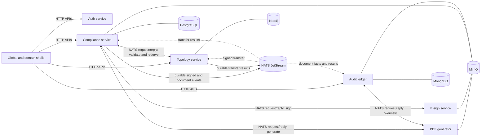

<!-- File: README.md -->
# Distributed Systems Architecture Portfolio

An aerospace-themed portfolio demonstrating custody transfers across a
microservice system. Organizations use federated UI workflows to prepare and
sign transfer authorizations and receipts; services validate custody, reconcile
events, and preserve an audit record. This is a local demonstration, not a
production flight-readiness or telemetry system.

[Explore the live demo](https://demo.tail098b41.ts.net/) (fictional data only).

## System and architecture



The arrows between services labeled request/reply are blocking NATS requests,
not direct HTTP links. Event delivery is asynchronous and retried using durable
outboxes. The [transfer workflow](./docs/architecture/transfer-workflow.md)
walks through the end-to-end flow, and the
[generated service composition and interaction view](./docs/generated/architecture/architecture.md)
shows the federated widgets and communication types.

### Services

Each service owns its data and documents its own behavior in its README:

| Service | Responsibility | Data |
| --- | --- | --- |
| [Topology](./services/core/topology-service/README.md) | Custody graph, asset/organization facts, reservations, atomic custody transitions | Neo4j |
| [Compliance](./services/core/compliance-service/README.md) | Document templates, drafts, signing coordination, durable signed-event publication | PostgreSQL, MinIO |
| [Audit ledger](./services/core/audit-ledger/README.md) | Event accumulation, sealed hash-chained transfer records, PDF overview renditions | MongoDB, MinIO |
| [Auth](./services/platform/auth-service/README.md) | Demo identities and short-lived JWTs; profile selector widget | — |
| [PDF generator](./services/platform/pdf-generator/README.md) | Renders and stores transfer PDFs on request | MinIO |
| [E-sign](./services/platform/esign-service/README.md) | Cryptographically signs PDFs with a P12 certificate | MinIO |
| [UI shells](./ui-shells/README.md) | Global and domain shells composing the federated widgets | — |

Current custodians and intended receivers of in-transit assets may view the
asset's full visual transfer history. Transfer participants can access their
own documents, while platform auditors have global read-only access. The
selected page is reflected in the URL, so reloading or sharing a page link
returns to the same page. Reservations cover authorizations and receipts to
prevent overlapping signatures. See the [ADRs](./docs/adr/) for design
decisions and the
[internal dependency reference](./docs/architecture/internal-reference.md) for
the generated workspace, contract, and boundary-call documentation.

## Quick start

Install Git and Docker, then bootstrap the workspace (installs pnpm, Node.js,
Python, kubectl, Helm, k3d, and Skaffold; prepares env files and credentials):

```bash
git clone git@github.com:Brickwall72/distributed-systems-architecture-portfolio.git
cd distributed-systems-architecture-portfolio
BUILD_DOCKER_BASE=true bash setup.sh
```

Start the integrated Kubernetes workflow and open
[http://localhost:8081](http://localhost:8081):

```bash
pnpm k3d:up        # create/select the local k3d cluster
pnpm helm          # install Traefik and shared middlewares
pnpm charts:deps   # vendor platform-lib into the charts
pnpm k8s:secrets   # create local Kubernetes credentials
pnpm skaffold      # build and deploy; leave running
```

See [environment setup](./docs/development/setup.md) for details and the
[Kubernetes development guide](./docs/development/kubernetes-development.md)
for verification checks, workflow semantics, and teardown. To work on
individual containers without Kubernetes, use the
[Compose workflow](./docs/development/compose-development.md). Use fictional
data only; the demo login is impersonable and local credentials are not a
production secret-management solution.

## Documentation

### Development

- [Development guide](./docs/development/) — index of all local workflows
- [Environment setup](./docs/development/setup.md)
- [Integrated Kubernetes development](./docs/development/kubernetes-development.md)
- [Service-level Compose development](./docs/development/compose-development.md)
- [Credentials, accounts, and resets](./docs/development/credentials-and-resets.md)
- [Testing](./docs/development/testing.md)
- [Observability (logs and Jaeger)](./docs/development/observability.md)
- [Cleanup and storage](./docs/development/cleanup-and-storage.md)
- [Troubleshooting](./docs/development/troubleshooting.md)

### Architecture

- [Transfer workflow](./docs/architecture/transfer-workflow.md) — end-to-end flow
- [Internal dependency reference](./docs/architecture/internal-reference.md) — generated reference docs
- [Browse the dependency reference](https://brickwall72.github.io/distributed-systems-architecture-portfolio/generated/dependencies/dependencies.html) — published HTML report
- [ADRs](./docs/adr/) — architecture decision records

### Operations (public demo VM)

- [Operations guide](./docs/operations/) — index
- [Demo secrets](./docs/operations/demo-secrets.md)
- [Demo VM data reset](./docs/operations/demo-vm-reset.md)
- [Demo UI publication and gated updates](./docs/operations/demo-ui-publication.md)
- [Tailscale Funnel smoke test](./docs/operations/funnel-smoke-test.md)

### Components

- [Services](./services/) — each service's README covers its data flow, APIs, messaging, and configuration
- [UI shells](./ui-shells/README.md) — module-federation composition and routing
- [Helm charts](./charts/README.md) — chart inventory and the platform-lib library chart
- [MinIO provisioning](./infrastructure/minio-setup/README.md) — bucket, account, and policy setup shared by Compose, Helm, and tests
- [Scripts](./scripts/README.md) — operational scripts grouped by concern

### Contributing

- [Configuration management and quality gate workflow](./docs/contributing.md) —
  branch naming, Conventional Commits, and the pull-request code gate
