<!-- File: docs/generated/architecture/architecture.md -->
# Generated service architecture

Runtime relationships come from `docs/architecture/model.json`; application images are discovered from `skaffold.yaml` without building images. The combined internal-report command derives page/widget composition from source; standalone overview generation uses the model's declared composition.

[Function/call reference](../dependencies/index.md)

```mermaid
flowchart LR
  classDef application fill:#172554,stroke:#60a5fa,color:#fff
  classDef shell fill:#312e81,stroke:#a78bfa,color:#fff
  classDef broker fill:#78350f,stroke:#f59e0b,color:#fff
  classDef storage fill:#14532d,stroke:#4ade80,color:#fff

  subgraph images[Application images from Skaffold]
    audit_client["audit-client"]:::application
    audit_server["audit-server"]:::application
    auth_client["auth-client"]:::application
    auth_server["auth-server"]:::application
    compliance_client["compliance-client"]:::application
    compliance_server["compliance-server"]:::application
    compliance_shell["compliance-shell"]:::shell
    dsap_minio_setup["dsap-minio-setup"]:::application
    esign_server["esign-server"]:::application
    global_shell["global-shell"]:::shell
    pdf_server["pdf-server"]:::application
    topology_client["topology-client"]:::application
    topology_server["topology-server"]:::application
    topology_shell["topology-shell"]:::shell
  end
  nats["NATS JetStream"]:::broker
  topology_db[("Neo4j (topology)")]:::storage
  compliance_db[("PostgreSQL (compliance)")]:::storage
  audit_db[("MongoDB (audit)")]:::storage
  minio[("MinIO object storage")]:::storage
  compliance_shell ==>|DocumentsReview.page: TransfersTable| audit_client
  compliance_shell ==>|DocumentsReview.page: DocumentsTable| compliance_client
  compliance_shell ==>|TransferAuthorization.page: ComplianceWorkflowWidget| compliance_client
  compliance_shell ==>|TransferAuthorization.page: TemplateSelector| compliance_client
  compliance_shell ==>|TransferAuthorization.page: AssetSelector| topology_client
  compliance_shell ==>|TransferAuthorization.page: OrganizationSelector| topology_client
  compliance_shell ==>|TransferReceipt.page: ComplianceWorkflowWidget| compliance_client
  compliance_shell ==>|TransferReceipt.page: DocumentsTable| compliance_client
  compliance_shell ==>|TransferReceipt.page: AssetSelector| topology_client
  compliance_shell ==>|TransferReceipt.page: OrganizationSelector| topology_client
  global_shell ==>|App: ProfileSelector| auth_client
  global_shell ==>|App: App| compliance_shell
  global_shell ==>|App: App| topology_shell
  topology_shell ==>|AssetRegistrationDashboard: AssetRegistration| topology_client
  topology_shell ==>|AssetRegistrationDashboard: NetworkCanvas| topology_client
  topology_shell ==>|AssetRegistrationDashboard: OrganizationSelector| topology_client
  topology_shell ==>|TransferHistory: NetworkCanvas| topology_client
  compliance_client -->|Compliance REST API| compliance_server
  topology_client -->|Topology REST API| topology_server
  audit_client -->|Audit REST API| audit_server
  auth_client -->|Authentication and profiles REST API| auth_server
  compliance_client -->|Presigned document download| minio
  audit_client -->|Presigned overview download| minio
  topology_server -->|Neo4j Bolt| topology_db
  compliance_server -->|PostgreSQL| compliance_db
  audit_server -->|MongoDB| audit_db
  pdf_server -->|S3 document upload| minio
  esign_server -->|S3 document read / upload| minio
  compliance_server <-->|Validate drafts and reserve transfers| topology_server
  compliance_server <-->|Generate PDF| pdf_server
  audit_server <-->|Generate PDF| pdf_server
  compliance_server <-->|Sign document| esign_server
  compliance_server -.->|Publish signed transfer and audit document events| nats
  nats -.->|Deliver signed transfer for reserved application| topology_server
  topology_server -.->|Publish committed transfer results| nats
  nats -.->|Deliver transfer results for reconciliation| compliance_server
  nats -.->|Deliver committed transfer results| audit_server
  nats -.->|Deliver signed authorization / receipt facts| audit_server
  linkStyle 0 stroke:#a78bfa,stroke-width:3px
  linkStyle 1 stroke:#a78bfa,stroke-width:3px
  linkStyle 2 stroke:#a78bfa,stroke-width:3px
  linkStyle 3 stroke:#a78bfa,stroke-width:3px
  linkStyle 4 stroke:#a78bfa,stroke-width:3px
  linkStyle 5 stroke:#a78bfa,stroke-width:3px
  linkStyle 6 stroke:#a78bfa,stroke-width:3px
  linkStyle 7 stroke:#a78bfa,stroke-width:3px
  linkStyle 8 stroke:#a78bfa,stroke-width:3px
  linkStyle 9 stroke:#a78bfa,stroke-width:3px
  linkStyle 10 stroke:#a78bfa,stroke-width:3px
  linkStyle 11 stroke:#a78bfa,stroke-width:3px
  linkStyle 12 stroke:#a78bfa,stroke-width:3px
  linkStyle 13 stroke:#a78bfa,stroke-width:3px
  linkStyle 14 stroke:#a78bfa,stroke-width:3px
  linkStyle 15 stroke:#a78bfa,stroke-width:3px
  linkStyle 16 stroke:#a78bfa,stroke-width:3px
  linkStyle 17 stroke:#2563eb,stroke-width:2px
  linkStyle 18 stroke:#2563eb,stroke-width:2px
  linkStyle 19 stroke:#2563eb,stroke-width:2px
  linkStyle 20 stroke:#2563eb,stroke-width:2px
  linkStyle 21 stroke:#2563eb,stroke-width:2px
  linkStyle 22 stroke:#2563eb,stroke-width:2px
  linkStyle 23 stroke:#16a34a,stroke-width:2px
  linkStyle 24 stroke:#16a34a,stroke-width:2px
  linkStyle 25 stroke:#16a34a,stroke-width:2px
  linkStyle 26 stroke:#16a34a,stroke-width:2px
  linkStyle 27 stroke:#16a34a,stroke-width:2px
  linkStyle 28 stroke:#c2410c,stroke-width:2px
  linkStyle 29 stroke:#c2410c,stroke-width:2px
  linkStyle 30 stroke:#c2410c,stroke-width:2px
  linkStyle 31 stroke:#c2410c,stroke-width:2px
  linkStyle 32 stroke:#0f766e,stroke-width:2px,stroke-dasharray: 6 4
  linkStyle 33 stroke:#0f766e,stroke-width:2px,stroke-dasharray: 6 4
  linkStyle 34 stroke:#0f766e,stroke-width:2px,stroke-dasharray: 6 4
  linkStyle 35 stroke:#0f766e,stroke-width:2px,stroke-dasharray: 6 4
  linkStyle 36 stroke:#0f766e,stroke-width:2px,stroke-dasharray: 6 4
  linkStyle 37 stroke:#0f766e,stroke-width:2px,stroke-dasharray: 6 4
```

## Interaction legend

- **HTTP / REST** - blue, solid line (`#2563eb`).
- **NATS request / reply** - orange, solid line (`#c2410c`).
- **NATS pub / sub** - teal, dashed line (`#0f766e`).
- **Database / object storage** - green, solid line (`#16a34a`).

**UI composition** uses thick, solid purple arrows (`#a78bfa`), labeled by page and widget. Arrowheads show direction; request/reply uses a two-headed arrow. NATS pub/sub uses separate publisher-to-broker and broker-to-subscriber edges. Storage nodes use a cylinder shape; edges identify the protocol or operation.
