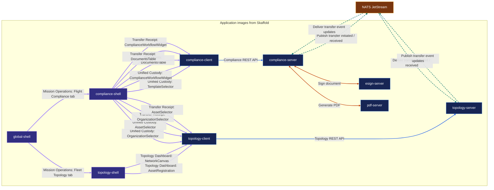

# Generated service architecture

This view is generated from `docs/architecture/model.json`; application image nodes are discovered from `skaffold.yaml` during CI. Update the model when page composition or service interactions change.

## Interaction legend

- **HTTP / REST**
- **NATS request / reply**
- **NATS pub / sub**

**UI composition** uses thick purple arrows, labeled by page and widget. NATS pub/sub is shown as separate publisher-to-broker and broker-to-subscriber edges.
